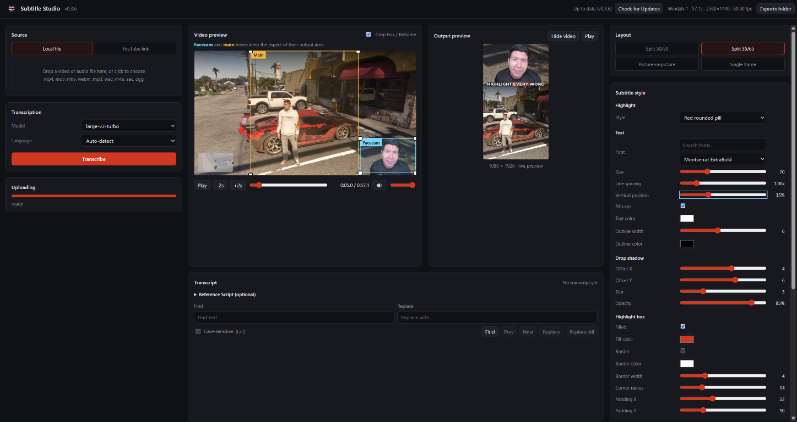
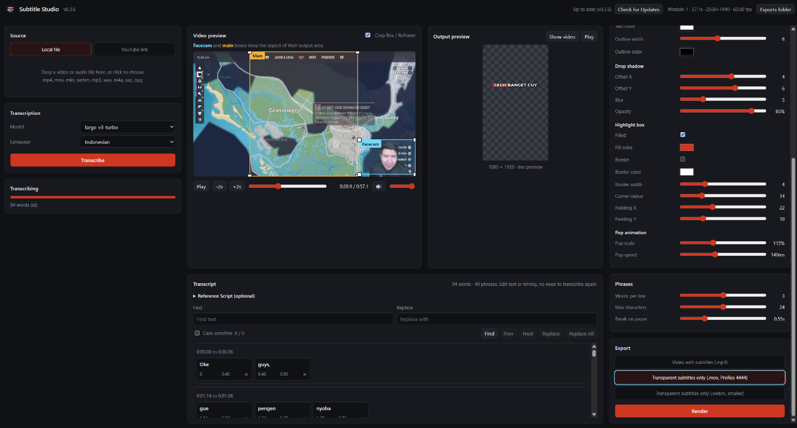

# 🎬 Subtitle Studio

**A local subtitle generator and video layout tool.**

Transcribe video or audio, edit word-level captions, style animated highlights, and
export a finished vertical video or a transparent subtitle overlay.


[](LICENSE)


> [!WARNING]
> 🚧 **Work in progress:** expect rough edges. This project was built with AI coding
> assistants and has not had a professional code or security review.
>
> 🔒 It runs **locally only**. Do **not** expose its server to a network or the
> internet.

---

## ✨ What it does

| Feature | Description |
| --- | --- |
| 🎙️ **Transcribe** | Turn video or audio into text with Whisper |
| ✏️ **Edit** | Fine-tune captions at the word level |
| 🎨 **Style** | Customize animated word highlights |
| 📱 **Export** | Render a finished vertical video |
| 🪟 **Overlay** | Export a transparent subtitle overlay |

## 🖼️ Screenshots



*Set up the video layout and subtitle style in the editor.*



*Edit word-level captions, fine-tune highlights, and choose an export format.*

## 🚀 Get started

### 📋 Requirements

| Requirement | Details |
| --- | --- |
| 🐍 **Python** | 3.10 or newer |
| 🎞️ **FFmpeg / FFprobe** | Must be available on your `PATH` |
| ⚡ **GPU (optional)** | NVIDIA GPU with CUDA 12.x recommended for faster transcription |
| 🐢 **CPU (fallback)** | Supported, but slower |

### 📥 Clone the repo

```bash
git clone https://github.com/rasuyas/subtitle-studio.git
cd subtitle-studio
```

### ▶️ Launch it

| Platform | Mode | How to launch |
| --- | --- | --- |
| 🪟 **Windows** | Desktop | Double-click `Subtitle Studio.bat` |
| 🍎 **macOS** | Desktop | Install FFmpeg, then double-click `Subtitle Studio.command` |
| 🐧 **Linux** | Desktop | Run `bash ./launch.sh` |
| 🌐 **Windows** | Browser | Run `launch.bat --web` |
| 🌐 **macOS / Linux** | Browser | Run `bash ./launch.sh --web` |

> 💡 **First run:** the launcher sets up the app for you. Your first transcription
> also downloads the selected Whisper model, so give it a moment.

## 📚 Documentation

| Guide | What's inside |
| --- | --- |
| 📦 [Installation and first run](docs/getting-started.md) | Prerequisites, download options, launch modes, and manual setup |
| 📖 [User guide](docs/user-guide.md) | Transcription, editing, styles, exports, and custom Whisper models |
| 🛠️ [Troubleshooting](docs/troubleshooting.md) | Common setup and rendering issues |
| 🐞 [Known issues and implementation notes](SPEC.md#known-issues) | Current limitations and technical notes |
| 📜 [Third-party software and font notices](docs/third-party-notices.md) | Dependency and font licenses |

## 📄 License

Subtitle Studio is licensed under the [MIT License](LICENSE). See the
[third-party notices](docs/third-party-notices.md) for dependency and font
information.

> ⚖️ Only process videos you own or have permission to use.
